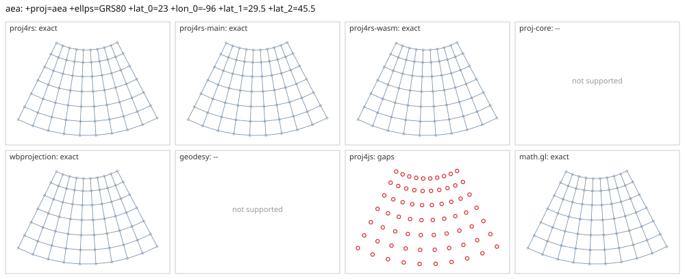

# aea

<!-- generated by report/projections.py from suites/projections/reference.json and engine results; do not edit -->

[Projections grid](../README.md) / [PROJ round trip](../proj-check.md) / [suite](../../../suites/projections/README.md)

```
+proj=aea +ellps=GRS80 +lat_0=23 +lon_0=-96 +lat_1=29.5 +lat_2=45.5
```

Source lon/lat for every engine: `+proj=longlat +ellps=GRS80 +no_defs`. Window lon [-140, -50], lat [10, 75], every 10 deg: 70 points, 70 projected by PROJ 9.10.0.

PROJ round trip (its inverse of its forward): worst 7.1e-14 deg at [-80, 70].



Blue: the graticule as each engine draws it. Grey rings: PROJ's points. Red rings: points where the engine is 1 m or more from PROJ, or gives nothing.

| engine | version | verdict | forward, worst | at lon, lat | inverse, worst | at lon, lat | no forward | no inverse | answers where PROJ refuses |
|---|---|---|---|---|---|---|---|---|---|
| proj4rs | 0.2.1 | exact | <1 nm | [-50, 10] | 5.8e-14 deg | [-50, 70] |  |  |  |
| proj4rs-main | git main | exact | <1 nm | [-140, 60] | 7.1e-15 deg | [-80, 50] |  |  |  |
| proj4rs-wasm | git d9a6284 2026-10-22 | exact | <1 nm | [-140, 60] | 1.4e-14 deg | [-140, 70] |  |  |  |
| proj-core | 0.12.0 | -- | operation selection failed: no compatible registry operation found for source EPSG:0 target EPSG:0 | | | | | | |
| wbprojection | 0.3.3 | exact | <1 nm | [-100, 30] | 8.9e-14 deg | [-140, 60] |  |  |  |
| terrio-crs | 0.1.0 + fallback | exact | <1 nm | [-140, 60] | 7.9e-14 deg | [-140, 60] |  |  |  |
| geodesy | 0.15.0 | -- | Operator 'aea' not found: aea ellps=GRS80 lat_0=23 lon_0=-96 lat_1=29.5 lat_2=45.5 | | | | | | |
| proj4js | 2.22.0 | gaps | 0 |  | 0 |  | 70 | 70 |  |
| math.gl | 5.0.0-alpha.18 | exact | <1 nm | [-90, 10] | 5.7e-14 deg | [-140, 70] |  |  |  |
