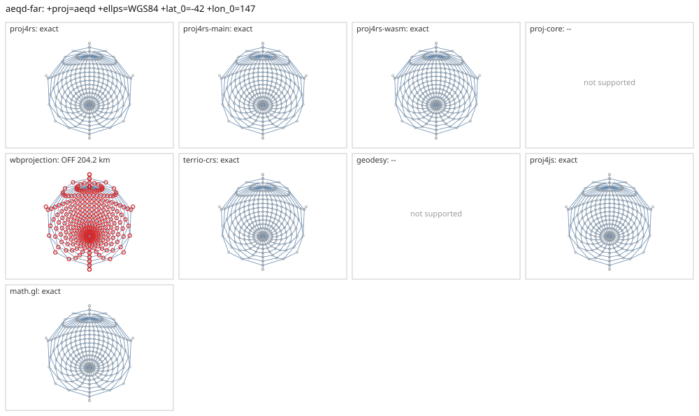

# aeqd-far

<!-- generated by report/projections.py from suites/projections/reference.json and engine results; do not edit -->

[Projections grid](../README.md) / [PROJ round trip](../proj-check.md) / [suite](../../../suites/projections/README.md)

```
+proj=aeqd +ellps=WGS84 +lat_0=-42 +lon_0=147
```

Source lon/lat for every engine: `+proj=longlat +ellps=WGS84 +no_defs`. Window lon [-33, 327], lat [-90, 90], every 15 deg: 325 points, 325 projected by PROJ 9.10.0.

Why this entry: aeqd far from the centre, up to the antipode (PROJ af3e08bf, 2026-07).

PROJ round trip (its inverse of its forward): worst 1.2e-13 deg at [312, 45].



Blue: the graticule as each engine draws it. Grey rings: PROJ's points. Red rings: points where the engine is 1 m or more from PROJ, or gives nothing.

| engine | version | verdict | forward, worst | at lon, lat | inverse, worst | at lon, lat | no forward | no inverse | answers where PROJ refuses |
|---|---|---|---|---|---|---|---|---|---|
| proj4rs | 0.2.1 | exact | <1 nm | [312, 30] | 6e-14 deg | [267, 0] |  |  |  |
| proj4rs-main | git main | exact | <1 nm | [312, 30] | 6e-14 deg | [267, 0] |  |  |  |
| proj4rs-wasm | git 60fee16 2026-10-26 | exact | <1 nm | [312, 30] | 5.7e-14 deg | [267, 0] |  |  |  |
| proj-core | 0.12.0 | -- | failed to parse CRS string: unsupported PROJ projection: aeqd | | | | | | |
| wbprojection | 0.3.3 | OFF 204.2 km | 204.2 km | [-18, 30] | 0.44 deg | [147, 60] |  |  |  |
| terrio-crs | 0.1.0 + fallback | exact | 0.298 mm | [312, 30] | 4.9e-10 deg | [27, 0] |  |  |  |
| geodesy | 0.15.0 | -- | Operator 'aeqd' not found: aeqd ellps=WGS84 lat_0=-42 lon_0=147 | | | | | | |
| proj4js | 2.22.0 | exact | 0.314 mm | [312, 30] | 4.9e-10 deg | [297, 30] |  |  |  |
| math.gl | 5.0.0-alpha.18 | exact | 0.314 mm | [312, 30] | 4.9e-10 deg | [297, 30] |  |  |  |
