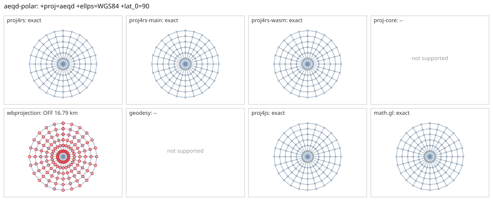

# aeqd-polar

<!-- generated by report/projections.py from suites/projections/reference.json and engine results; do not edit -->

[Projections grid](../README.md) / [PROJ round trip](../proj-check.md) / [suite](../../../suites/projections/README.md)

```
+proj=aeqd +ellps=WGS84 +lat_0=90
```

Source lon/lat for every engine: `+proj=longlat +ellps=WGS84 +no_defs`. Window lon [-180, 180], lat [0, 90], every 15 deg: 175 points, 175 projected by PROJ 9.10.0.

PROJ round trip (its inverse of its forward): worst 1.8e-14 deg at [-180, 15].



Blue: the graticule as each engine draws it. Grey rings: PROJ's points. Red rings: points where the engine is 1 m or more from PROJ, or gives nothing.

| engine | version | verdict | forward, worst | at lon, lat | inverse, worst | at lon, lat | no forward | no inverse | answers where PROJ refuses |
|---|---|---|---|---|---|---|---|---|---|
| proj4rs | 0.2.1 | exact | 0.00392 mm | [-165, 75] | 3.5e-11 deg | [-180, 75] |  |  |  |
| proj4rs-main | git main | exact | 0 |  | 1.2e-14 deg | [-150, 15] |  |  |  |
| proj4rs-wasm | git d9a6284 2026-10-22 | exact | 0 |  | 2.7e-14 deg | [-120, 15] |  |  |  |
| proj-core | 0.12.0 | -- | failed to parse CRS string: unsupported PROJ projection: aeqd | | | | | | |
| wbprojection | 0.3.3 | OFF 16.79 km | 16.79 km | [-150, 0] | 0.15 deg | [-105, 0] |  |  |  |
| terrio-crs | 0.1.0 + fallback | exact | 0.00392 mm | [-165, 75] | 3.5e-11 deg | [-180, 75] |  |  |  |
| geodesy | 0.15.0 | -- | Operator 'aeqd' not found: aeqd ellps=WGS84 lat_0=90 | | | | | | |
| proj4js | 2.22.0 | exact | 0.697 mm | [-165, 75] | 6.2e-09 deg | [-120, 75] |  |  |  |
| math.gl | 5.0.0-alpha.18 | exact | <1 nm | [-165, 15] | 2.9e-14 deg | [-120, 0] |  |  |  |
