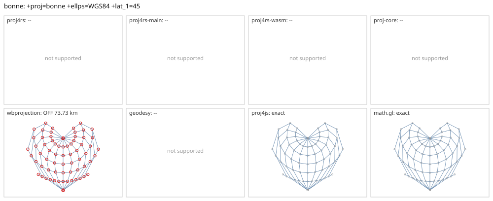

# bonne

<!-- generated by report/projections.py from suites/projections/reference.json and engine results; do not edit -->

[Projections grid](../README.md) / [PROJ round trip](../proj-check.md) / [suite](../../../suites/projections/README.md)

```
+proj=bonne +ellps=WGS84 +lat_1=45
```

Source lon/lat for every engine: `+proj=longlat +ellps=WGS84 +no_defs`. Window lon [-180, 180], lat [-90, 90], every 30 deg: 91 points, 91 projected by PROJ 9.10.0.

PROJ round trip (its inverse of its forward): worst 6.4e-14 deg at [-30, -60].



Blue: the graticule as each engine draws it. Grey rings: PROJ's points. Red rings: points where the engine is 1 m or more from PROJ, or gives nothing.

| engine | version | verdict | forward, worst | at lon, lat | inverse, worst | at lon, lat | no forward | no inverse | answers where PROJ refuses |
|---|---|---|---|---|---|---|---|---|---|
| proj4rs | 0.2.1 | -- | Projection not found | | | | | | |
| proj4rs-main | git main | -- | Projection not found | | | | | | |
| proj4rs-wasm | git d9a6284 2026-10-22 | -- | Projection not found | | | | | | |
| proj-core | 0.12.0 | -- | failed to parse CRS string: unsupported PROJ projection: bonne | | | | | | |
| wbprojection | 0.3.3 | OFF 73.73 km | 73.73 km | [-180, -30] | 1 deg | [-180, -60] |  |  |  |
| geodesy | 0.15.0 | -- | Operator 'bonne' not found: bonne ellps=WGS84 lat_1=45 | | | | | | |
| proj4js | 2.22.0 | exact | 0.00602 mm | [-180, 60] | 1.1e-10 deg | [-180, -60] |  |  |  |
| math.gl | 5.0.0-alpha.18 | exact | 0.00602 mm | [-180, 60] | 1.1e-10 deg | [-180, -60] |  |  |  |
