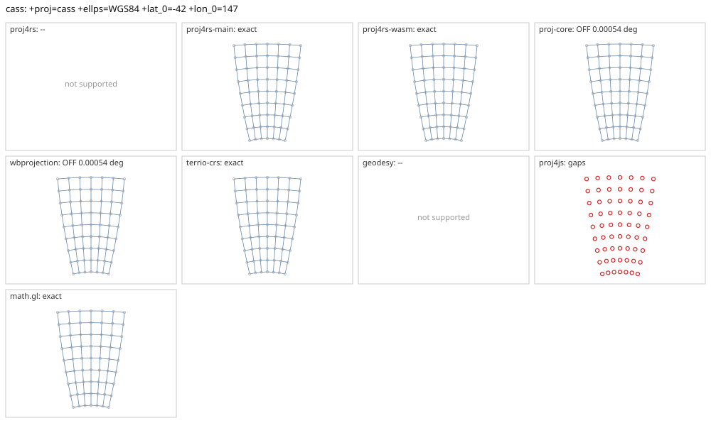

# cass

<!-- generated by report/projections.py from suites/projections/reference.json and engine results; do not edit -->

[Projections grid](../README.md) / [PROJ round trip](../proj-check.md) / [suite](../../../suites/projections/README.md)

```
+proj=cass +ellps=WGS84 +lat_0=-42 +lon_0=147
```

Source lon/lat for every engine: `+proj=longlat +ellps=WGS84 +no_defs`. Window lon [132, 162], lat [-60, -20], every 5 deg: 63 points, 63 projected by PROJ 9.10.0.

PROJ round trip (its inverse of its forward): worst 2.9e-11 deg at [132, -35].



Blue: the graticule as each engine draws it. Grey rings: PROJ's points. Red rings: points where the engine is 1 m or more from PROJ, or gives nothing.

| engine | version | verdict | forward, worst | at lon, lat | inverse, worst | at lon, lat | no forward | no inverse | answers where PROJ refuses |
|---|---|---|---|---|---|---|---|---|---|
| proj4rs | 0.2.1 | -- | Projection not found | | | | | | |
| proj4rs-main | git main | exact | 0 |  | 2.3e-14 deg | [157, -40] |  |  |  |
| proj4rs-wasm | git d9a6284 2026-10-22 | exact | <1 nm | [132, -55] | 2.3e-14 deg | [157, -40] |  |  |  |
| proj-core | 0.12.0 | OFF 0.00054 deg | 0.579 mm | [132, -60] | 0.00054 deg | [162, -60] |  |  |  |
| wbprojection | 0.3.3 | OFF 0.00054 deg | 0.579 mm | [132, -60] | 0.00054 deg | [162, -60] |  |  |  |
| geodesy | 0.15.0 | -- | Operator 'cass' not found: cass ellps=WGS84 lat_0=-42 lon_0=147 | | | | | | |
| proj4js | 2.22.0 | gaps | 0 |  | 0 |  | 63 | 63 |  |
| math.gl | 5.0.0-alpha.18 | exact | 0.00283 mm | [132, -60] | 2.8e-11 deg | [162, -35] |  |  |  |
