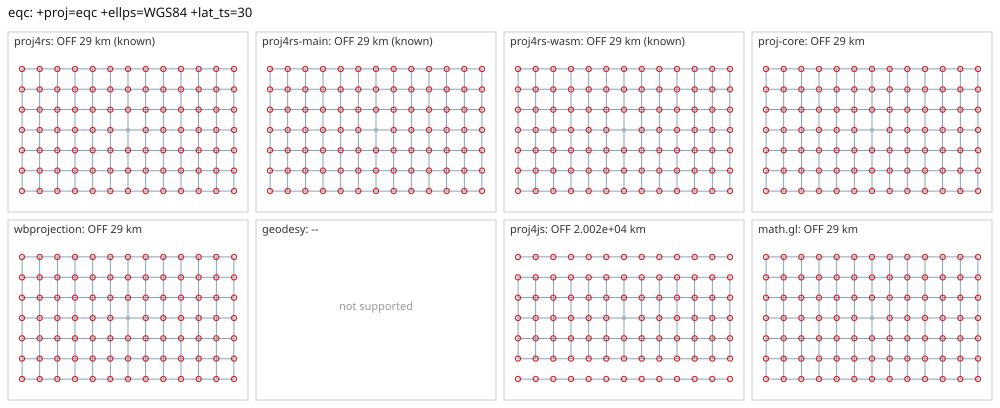

# eqc

<!-- generated by report/projections.py from suites/projections/reference.json and engine results; do not edit -->

[Projections grid](../README.md) / [PROJ round trip](../proj-check.md) / [suite](../../../suites/projections/README.md)

```
+proj=eqc +ellps=WGS84 +lat_ts=30
```

Source lon/lat for every engine: `+proj=longlat +ellps=WGS84 +no_defs`. Window lon [-180, 180], lat [-90, 90], every 30 deg: 91 points, 91 projected by PROJ 9.10.0.

PROJ round trip (its inverse of its forward): worst 5.7e-14 deg at [-120, 0].



Blue: the graticule as each engine draws it. Grey rings: PROJ's points. Red rings: points where the engine is 1 m or more from PROJ, or gives nothing.

| engine | version | verdict | forward, worst | at lon, lat | inverse, worst | at lon, lat | no forward | no inverse | answers where PROJ refuses |
|---|---|---|---|---|---|---|---|---|---|
| proj4rs | 0.2.1 | OFF 29 km (known) | 29 km | [-180, -60] | 0.24 deg | [-180, -60] |  |  |  |
| proj4rs-main | git main | OFF 29 km (known) | 29 km | [-180, -60] | 0.24 deg | [-180, -60] |  |  |  |
| proj4rs-wasm | git d9a6284 2026-10-22 | OFF 29 km (known) | 29 km | [-180, -60] | 0.24 deg | [-180, -60] |  |  |  |
| proj-core | 0.12.0 | OFF 29 km | 29 km | [-180, -60] | 0.24 deg | [-180, -60] |  |  |  |
| wbprojection | 0.3.3 | OFF 29 km | 29 km | [-180, -60] | 0.24 deg | [-180, -60] |  |  |  |
| geodesy | 0.15.0 | -- | Operator 'eqc' not found: eqc ellps=WGS84 lat_ts=30 | | | | | | |
| proj4js | 2.22.0 | OFF 2.002e+04 km | 2.002e+04 km | [-180, -90] | 0.24 deg | [-180, -60] |  |  |  |
| math.gl | 5.0.0-alpha.18 | OFF 29 km | 29 km | [-180, -60] | 0.24 deg | [-180, -60] |  |  |  |

Known differences, recorded in [projections.json](../../../suites/projections/projections.json):

- proj4rs: PROJ (since 9.8) uses the ellipsoidal form (EPSG method 1028), proj4rs the spherical form with radius a.
- proj4rs-main: PROJ (since 9.8) uses the ellipsoidal form (EPSG method 1028), proj4rs the spherical form with radius a.
- proj4rs-wasm: PROJ (since 9.8) uses the ellipsoidal form (EPSG method 1028), proj4rs the spherical form with radius a.
