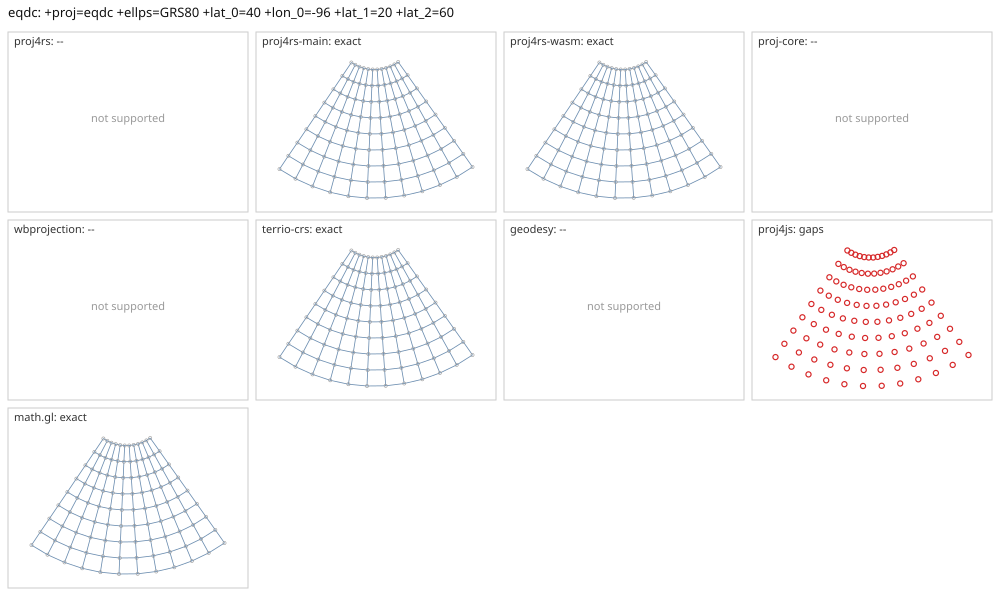

# eqdc

<!-- generated by report/projections.py from suites/projections/reference.json and engine results; do not edit -->

[Projections grid](../README.md) / [PROJ round trip](../proj-check.md) / [suite](../../../suites/projections/README.md)

```
+proj=eqdc +ellps=GRS80 +lat_0=40 +lon_0=-96 +lat_1=20 +lat_2=60
```

Source lon/lat for every engine: `+proj=longlat +ellps=GRS80 +no_defs`. Window lon [-150, -40], lat [0, 80], every 10 deg: 108 points, 108 projected by PROJ 9.10.0.

PROJ round trip (its inverse of its forward): worst 2.2e-14 deg at [-150, 40].



Blue: the graticule as each engine draws it. Grey rings: PROJ's points. Red rings: points where the engine is 1 m or more from PROJ, or gives nothing.

| engine | version | verdict | forward, worst | at lon, lat | inverse, worst | at lon, lat | no forward | no inverse | answers where PROJ refuses |
|---|---|---|---|---|---|---|---|---|---|
| proj4rs | 0.2.1 | -- | Projection not found | | | | | | |
| proj4rs-main | git main | exact | 0 |  | 1.4e-14 deg | [-40, 70] |  |  |  |
| proj4rs-wasm | git d9a6284 2026-10-22 | exact | 0 |  | 9.7e-15 deg | [-120, 70] |  |  |  |
| proj-core | 0.12.0 | -- | failed to parse CRS string: unsupported PROJ projection: eqdc | | | | | | |
| wbprojection | 0.3.3 | -- | unsupported projection: PROJ +proj=eqdc is not supported by wbprojection | | | | | | |
| terrio-crs | 0.1.0 + fallback | exact | 0.00449 mm | [-100, 70] | 4e-11 deg | [-100, 70] |  |  |  |
| geodesy | 0.15.0 | -- | Operator 'eqdc' not found: eqdc ellps=GRS80 lat_0=40 lon_0=-96 lat_1=20 lat_2=60 | | | | | | |
| proj4js | 2.22.0 | gaps | 0 |  | 0 |  | 108 | 108 |  |
| math.gl | 5.0.0-alpha.18 | exact | 0.00449 mm | [-100, 70] | 4e-11 deg | [-100, 70] |  |  |  |
