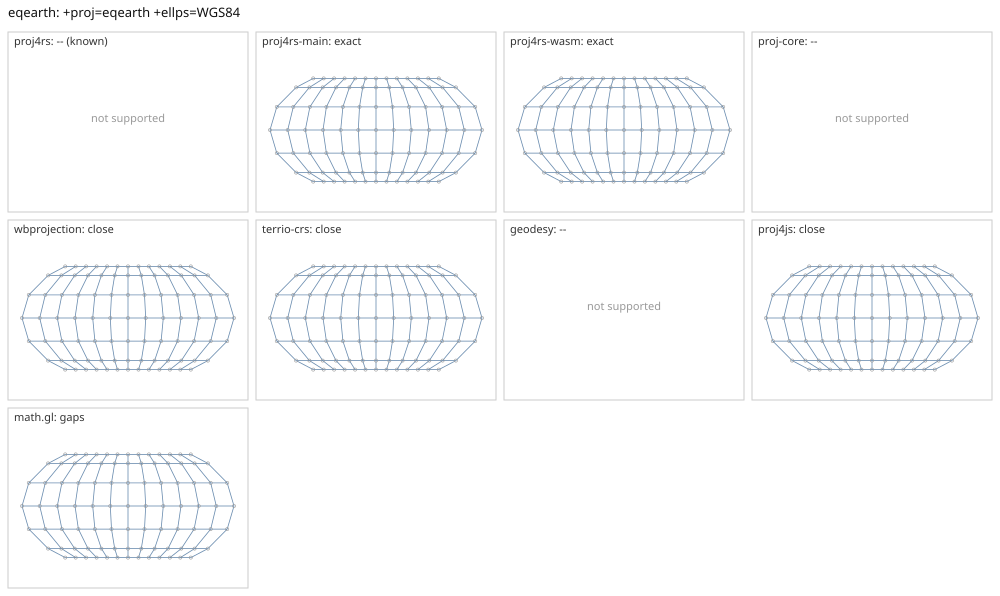

# eqearth

<!-- generated by report/projections.py from suites/projections/reference.json and engine results; do not edit -->

[Projections grid](../README.md) / [PROJ round trip](../proj-check.md) / [suite](../../../suites/projections/README.md)

```
+proj=eqearth +ellps=WGS84
```

Source lon/lat for every engine: `+proj=longlat +ellps=WGS84 +no_defs`. Window lon [-180, 180], lat [-90, 90], every 30 deg: 91 points, 91 projected by PROJ 9.10.0.

PROJ round trip (its inverse of its forward): worst 6.6e-06 deg at [-180, -90].



Blue: the graticule as each engine draws it. Grey rings: PROJ's points. Red rings: points where the engine is 1 m or more from PROJ, or gives nothing.

| engine | version | verdict | forward, worst | at lon, lat | inverse, worst | at lon, lat | no forward | no inverse | answers where PROJ refuses |
|---|---|---|---|---|---|---|---|---|---|
| proj4rs | 0.2.1 | -- (known) | Projection not found | | | | | | |
| proj4rs-main | git main | exact | 0 |  | 2.5e-14 deg | [-150, -30] |  |  |  |
| proj4rs-wasm | git 9996719 2026-10-21 | exact | 0 |  | 1.4e-14 deg | [-180, -90] |  |  |  |
| proj-core | 0.12.0 | -- | failed to parse CRS string: unsupported PROJ projection: eqearth | | | | | | |
| wbprojection | 0.3.3 | close | <1 nm | [-150, -60] | 4.8e-08 deg | [-180, 90] |  |  |  |
| geodesy | 0.15.0 | -- | Operator 'eqearth' not found: eqearth ellps=WGS84 | | | | | | |
| proj4js | 2.22.0 | close | <1 nm | [-180, -90] | 6.6e-06 deg | [-180, -90] |  |  |  |
| math.gl | 5.0.0-alpha.18 | gaps | <1 nm | [-180, -60] | 1.2e-08 deg | [-180, -30] |  | 26 |  |

Known differences, recorded in [projections.json](../../../suites/projections/projections.json):

- proj4rs: inverse 6.6e-6 deg at the poles only; elsewhere within 1.5e-14 deg.
