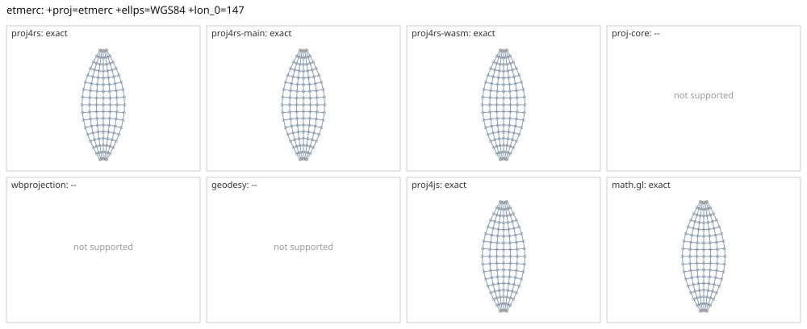

# etmerc

<!-- generated by report/projections.py from suites/projections/reference.json and engine results; do not edit -->

[Projections grid](../README.md) / [PROJ round trip](../proj-check.md) / [suite](../../../suites/projections/README.md)

```
+proj=etmerc +ellps=WGS84 +lon_0=147
```

Source lon/lat for every engine: `+proj=longlat +ellps=WGS84 +no_defs`. Window lon [117, 177], lat [-80, 80], every 10 deg: 119 points, 119 projected by PROJ 9.10.0.

PROJ round trip (its inverse of its forward): worst 2.7e-14 deg at [177, -20].



Blue: the graticule as each engine draws it. Grey rings: PROJ's points. Red rings: points where the engine is 1 m or more from PROJ, or gives nothing.

| engine | version | verdict | forward, worst | at lon, lat | inverse, worst | at lon, lat | no forward | no inverse | answers where PROJ refuses |
|---|---|---|---|---|---|---|---|---|---|
| proj4rs | 0.2.1 | exact | <1 nm | [127, -20] | 2.2e-14 deg | [177, -40] |  |  |  |
| proj4rs-main | git main | exact | <1 nm | [127, -20] | 2.2e-14 deg | [177, -40] |  |  |  |
| proj4rs-wasm | git 60fee16 2026-10-26 | exact | <1 nm | [127, -20] | 2.7e-14 deg | [177, -20] |  |  |  |
| proj-core | 0.12.0 | -- | failed to parse CRS string: unsupported PROJ projection: etmerc | | | | | | |
| wbprojection | 0.3.3 | -- | unsupported projection: PROJ +proj=etmerc is not supported by wbprojection | | | | | | |
| terrio-crs | 0.1.0 + fallback | exact | <1 nm | [117, -10] | 2.2e-14 deg | [177, -40] |  |  |  |
| geodesy | 0.15.0 | -- | Operator 'etmerc' not found: etmerc ellps=WGS84 lon_0=147 | | | | | | |
| proj4js | 2.22.0 | exact | <1 nm | [127, -40] | 2.7e-14 deg | [177, -20] |  |  |  |
| math.gl | 5.0.0-alpha.18 | exact | <1 nm | [157, -30] | 2.7e-14 deg | [177, -20] |  |  |  |
