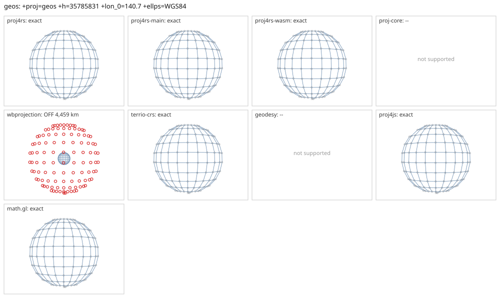

# geos

<!-- generated by report/projections.py from suites/projections/reference.json and engine results; do not edit -->

[Projections grid](../README.md) / [PROJ round trip](../proj-check.md) / [suite](../../../suites/projections/README.md)

```
+proj=geos +h=35785831 +lon_0=140.7 +ellps=WGS84
```

Source lon/lat for every engine: `+proj=longlat +ellps=WGS84 +no_defs`. Window lon [50, 231], lat [-81, 81], every 15 deg: 156 points, 107 projected by PROJ 9.10.0.

PROJ round trip (its inverse of its forward): worst 3.7e-11 deg at [155, -81].



Blue: the graticule as each engine draws it. Grey rings: PROJ's points. Red rings: points where the engine is 1 m or more from PROJ, or gives nothing.

| engine | version | verdict | forward, worst | at lon, lat | inverse, worst | at lon, lat | no forward | no inverse | answers where PROJ refuses |
|---|---|---|---|---|---|---|---|---|---|
| proj4rs | 0.2.1 | exact | <1 nm | [200, 69] | 2.8e-14 deg | [170, 9] |  |  |  |
| proj4rs-main | git main | exact | <1 nm | [200, 69] | 2.8e-14 deg | [170, 9] |  |  |  |
| proj4rs-wasm | git d9a6284 2026-10-22 | exact | <1 nm | [185, -36] | 2.8e-14 deg | [170, 9] |  |  |  |
| proj-core | 0.12.0 | -- | failed to parse CRS string: unsupported PROJ projection: geos | | | | | | |
| wbprojection | 0.3.3 | OFF 4,459 km | 4,459 km | [65, -51] | 32 deg | [140, -6] |  | 106 | 49 |
| geodesy | 0.15.0 | -- | Operator 'geos' not found: geos h=35785831 lon_0=140.7 ellps=WGS84 | | | | | | |
| proj4js | 2.22.0 | exact | <1 nm | [155, -66] | 3.3e-13 deg | [155, 54] |  |  |  |
| math.gl | 5.0.0-alpha.18 | exact | <1 nm | [155, -66] | 3.2e-13 deg | [155, 54] |  |  |  |
