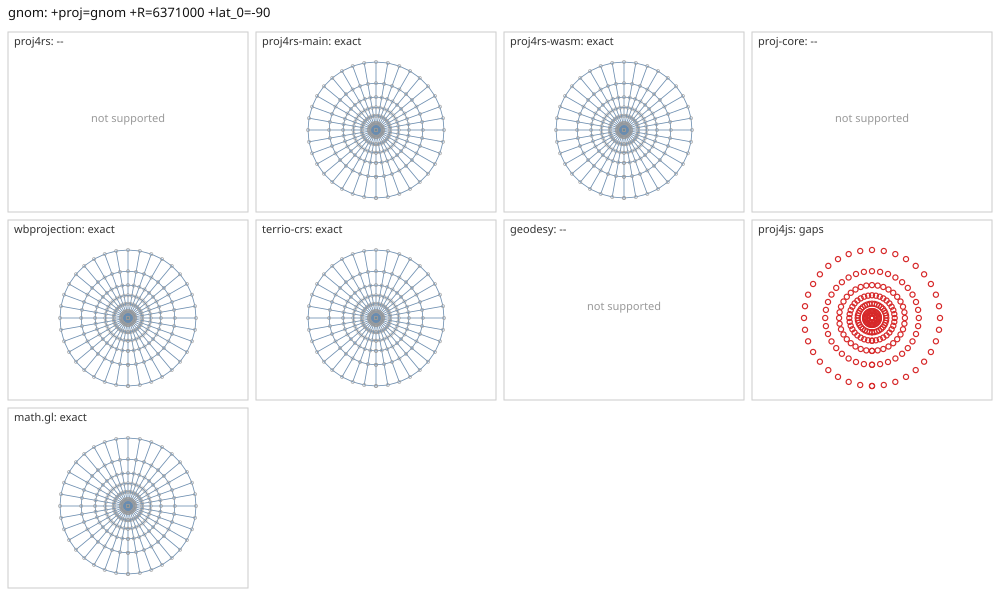

# gnom

<!-- generated by report/projections.py from suites/projections/reference.json and engine results; do not edit -->

[Projections grid](../README.md) / [PROJ round trip](../proj-check.md) / [suite](../../../suites/projections/README.md)

```
+proj=gnom +R=6371000 +lat_0=-90
```

Source lon/lat for every engine: `+proj=longlat +R=6371000 +no_defs`. Window lon [-180, 180], lat [-90, -30], every 10 deg: 259 points, 259 projected by PROJ 9.10.0.

PROJ round trip (its inverse of its forward): worst 2.1e-14 deg at [-180, -60].



Blue: the graticule as each engine draws it. Grey rings: PROJ's points. Red rings: points where the engine is 1 m or more from PROJ, or gives nothing.

| engine | version | verdict | forward, worst | at lon, lat | inverse, worst | at lon, lat | no forward | no inverse | answers where PROJ refuses |
|---|---|---|---|---|---|---|---|---|---|
| proj4rs | 0.2.1 | -- | Projection not found | | | | | | |
| proj4rs-main | git main | exact | 0 |  | 1.4e-14 deg | [-150, -70] |  |  |  |
| proj4rs-wasm | git d9a6284 2026-10-22 | exact | 0 |  | 2.5e-14 deg | [-120, -30] |  |  |  |
| proj-core | 0.12.0 | -- | geographic: unsupported CRS semantics: PROJ geographic CRS definition uses unsupported PROJ parameter `+r`: custom ellipsoid parameters are not supported; use a supported +ellps value | | | | | | |
| wbprojection | 0.3.3 | exact | <1 nm | [-150, -30] | 2.6e-14 deg | [-150, -30] |  |  |  |
| geodesy | 0.15.0 | -- | Operator 'gnom' not found: gnom R=6371000 lat_0=-90 | | | | | | |
| proj4js | 2.22.0 | gaps | 0 |  | 0 |  | 259 | 259 |  |
| math.gl | 5.0.0-alpha.18 | exact | <1 nm | [-20, -30] | 1.5e-14 deg | [-140, -80] |  |  |  |
