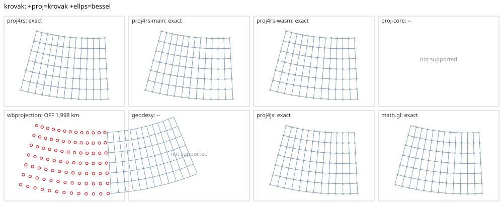

# krovak

<!-- generated by report/projections.py from suites/projections/reference.json and engine results; do not edit -->

[Projections grid](../README.md) / [PROJ round trip](../proj-check.md) / [suite](../../../suites/projections/README.md)

```
+proj=krovak +ellps=bessel
```

Source lon/lat for every engine: `+proj=longlat +ellps=bessel +no_defs`. Window lon [5, 30], lat [44, 56], every 2 deg: 91 points, 91 projected by PROJ 9.10.0.

PROJ round trip (its inverse of its forward): worst 2.4e-13 deg at [7, 56].



Blue: the graticule as each engine draws it. Grey rings: PROJ's points. Red rings: points where the engine is 1 m or more from PROJ, or gives nothing.

| engine | version | verdict | forward, worst | at lon, lat | inverse, worst | at lon, lat | no forward | no inverse | answers where PROJ refuses |
|---|---|---|---|---|---|---|---|---|---|
| proj4rs | 0.2.1 | exact | 0 |  | 7.1e-15 deg | [5, 44] |  |  |  |
| proj4rs-main | git main | exact | 0 |  | 7.1e-15 deg | [5, 44] |  |  |  |
| proj4rs-wasm | git d9a6284 2026-10-22 | exact | <1 nm | [13, 54] | 2.8e-14 deg | [11, 44] |  |  |  |
| proj-core | 0.12.0 | -- | failed to parse CRS string: unsupported PROJ projection: krovak | | | | | | |
| wbprojection | 0.3.3 | OFF 1,998 km | 1,998 km | [29, 44] | 18 deg | [29, 44] |  |  |  |
| geodesy | 0.15.0 | -- | Operator 'krovak' not found: krovak ellps=bessel | | | | | | |
| proj4js | 2.22.0 | exact | <1 nm | [9, 54] | 4.3e-12 deg | [21, 44] |  |  |  |
| math.gl | 5.0.0-alpha.18 | exact | <1 nm | [7, 56] | 4.3e-12 deg | [21, 44] |  |  |  |
