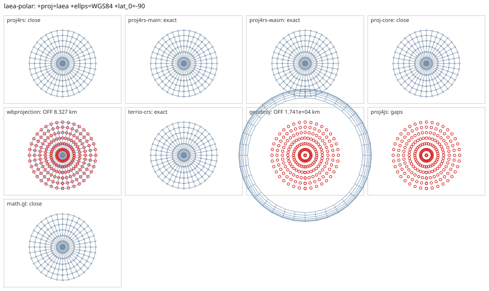

# laea-polar

<!-- generated by report/projections.py from suites/projections/reference.json and engine results; do not edit -->

[Projections grid](../README.md) / [PROJ round trip](../proj-check.md) / [suite](../../../suites/projections/README.md)

```
+proj=laea +ellps=WGS84 +lat_0=-90
```

Source lon/lat for every engine: `+proj=longlat +ellps=WGS84 +no_defs`. Window lon [-180, 180], lat [-90, -30], every 10 deg: 259 points, 259 projected by PROJ 9.10.0.

PROJ round trip (its inverse of its forward): worst 1.4e-14 deg at [-180, -80].



Blue: the graticule as each engine draws it. Grey rings: PROJ's points. Red rings: points where the engine is 1 m or more from PROJ, or gives nothing.

| engine | version | verdict | forward, worst | at lon, lat | inverse, worst | at lon, lat | no forward | no inverse | answers where PROJ refuses |
|---|---|---|---|---|---|---|---|---|---|
| proj4rs | 0.2.1 | close | 190 mm | [-180, -90] | 1.2e-08 deg | [-170, -30] |  |  |  |
| proj4rs-main | git main | exact | 0 |  | 1.4e-14 deg | [-110, -50] |  |  |  |
| proj4rs-wasm | git 9996719 2026-10-21 | exact | 0 |  | 2.5e-14 deg | [-120, -30] |  |  |  |
| proj-core | 0.12.0 | close | 190 mm | [-60, -90] | 1.2e-08 deg | [160, -30] |  |  |  |
| wbprojection | 0.3.3 | OFF 8.327 km | 8.327 km | [-50, -50] | 0.08 deg | [-110, -50] |  |  |  |
| geodesy | 0.15.0 | OFF 1.741e+04 km | 1.741e+04 km | [-180, -30] | 1.7e+02 deg | [-180, -30] |  |  |  |
| proj4js | 2.22.0 | gaps | 0 |  | 0 |  | 259 | 259 |  |
| math.gl | 5.0.0-alpha.18 | close | <1 nm | [-150, -80] | 1.2e-08 deg | [-130, -30] |  |  |  |
