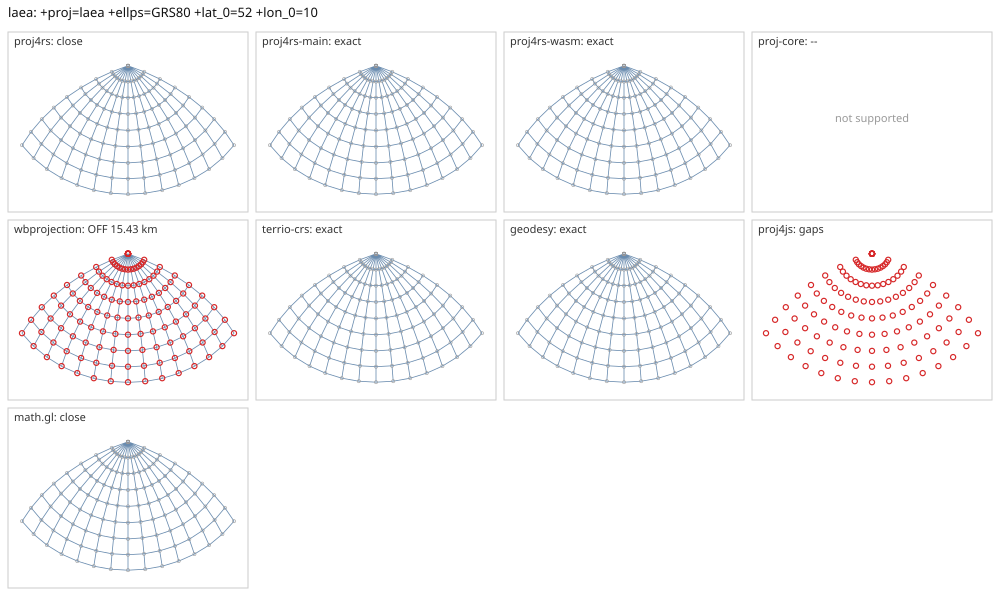

# laea

<!-- generated by report/projections.py from suites/projections/reference.json and engine results; do not edit -->

[Projections grid](../README.md) / [PROJ round trip](../proj-check.md) / [suite](../../../suites/projections/README.md)

```
+proj=laea +ellps=GRS80 +lat_0=52 +lon_0=10
```

Source lon/lat for every engine: `+proj=longlat +ellps=GRS80 +no_defs`. Window lon [-60, 80], lat [10, 90], every 10 deg: 135 points, 135 projected by PROJ 9.10.0.

PROJ round trip (its inverse of its forward): worst 5.7e-14 deg at [-30, 80].



Blue: the graticule as each engine draws it. Grey rings: PROJ's points. Red rings: points where the engine is 1 m or more from PROJ, or gives nothing.

| engine | version | verdict | forward, worst | at lon, lat | inverse, worst | at lon, lat | no forward | no inverse | answers where PROJ refuses |
|---|---|---|---|---|---|---|---|---|---|
| proj4rs | 0.2.1 | close | <1 nm | [-60, 80] | 1.4e-08 deg | [-60, 20] |  |  |  |
| proj4rs-main | git main | exact | 0 |  | 1.4e-14 deg | [-40, 40] |  |  |  |
| proj4rs-wasm | git 60fee16 2026-10-26 | exact | 0 |  | 4.3e-14 deg | [60, 80] |  |  |  |
| proj-core | 0.12.0 | -- | operation selection failed: no compatible registry operation found for source EPSG:0 target EPSG:0 | | | | | | |
| wbprojection | 0.3.3 | OFF 15.43 km | 15.43 km | [10, 10] | 0.15 deg | [10, 10] |  |  |  |
| terrio-crs | 0.1.0 + fallback | exact | <1 nm | [-60, 80] | 7.2e-14 deg | [-50, 80] |  |  |  |
| geodesy | 0.15.0 | exact | <1 nm | [0, 10] | 8.5e-14 deg | [-30, 80] |  |  |  |
| proj4js | 2.22.0 | gaps | 0 |  | 0 |  | 135 | 135 |  |
| math.gl | 5.0.0-alpha.18 | close | <1 nm | [-60, 80] | 2e-08 deg | [-60, 20] |  |  |  |
