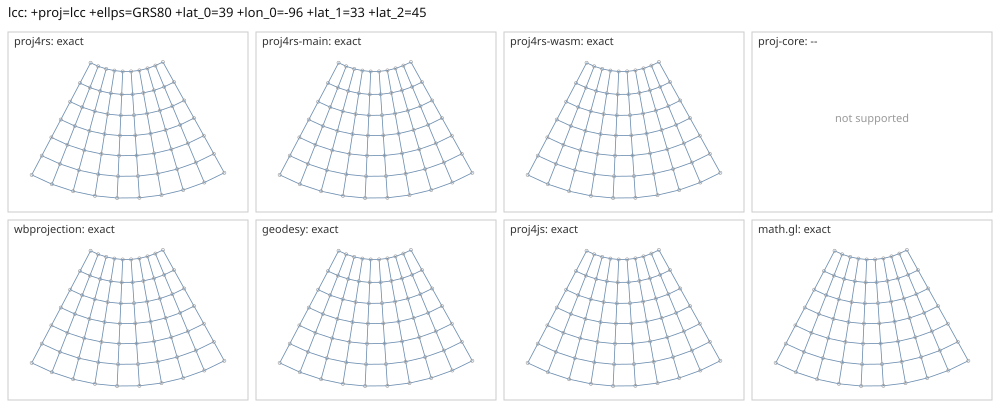

# lcc

<!-- generated by report/projections.py from suites/projections/reference.json and engine results; do not edit -->

[Projections grid](../README.md) / [PROJ round trip](../proj-check.md) / [suite](../../../suites/projections/README.md)

```
+proj=lcc +ellps=GRS80 +lat_0=39 +lon_0=-96 +lat_1=33 +lat_2=45
```

Source lon/lat for every engine: `+proj=longlat +ellps=GRS80 +no_defs`. Window lon [-140, -50], lat [10, 75], every 10 deg: 70 points, 70 projected by PROJ 9.10.0.

PROJ round trip (its inverse of its forward): worst 2.1e-14 deg at [-80, 50].



Blue: the graticule as each engine draws it. Grey rings: PROJ's points. Red rings: points where the engine is 1 m or more from PROJ, or gives nothing.

| engine | version | verdict | forward, worst | at lon, lat | inverse, worst | at lon, lat | no forward | no inverse | answers where PROJ refuses |
|---|---|---|---|---|---|---|---|---|---|
| proj4rs | 0.2.1 | exact | <1 nm | [-70, 20] | 1.1e-11 deg | [-140, 50] |  |  |  |
| proj4rs-main | git main | exact | <1 nm | [-70, 20] | 1.1e-11 deg | [-140, 50] |  |  |  |
| proj4rs-wasm | git 60fee16 2026-10-26 | exact | <1 nm | [-70, 20] | 1.1e-11 deg | [-140, 50] |  |  |  |
| proj-core | 0.12.0 | -- | operation selection failed: no compatible registry operation found for source EPSG:0 target EPSG:0 | | | | | | |
| wbprojection | 0.3.3 | exact | <1 nm | [-140, 20] | 1.8e-13 deg | [-60, 40] |  |  |  |
| terrio-crs | 0.1.0 + fallback | exact | <1 nm | [-70, 20] | 3.5e-14 deg | [-60, 10] |  |  |  |
| geodesy | 0.15.0 | exact | <1 nm | [-140, 10] | 7.5e-14 deg | [-140, 20] |  |  |  |
| proj4js | 2.22.0 | exact | <1 nm | [-140, 10] | 1.1e-11 deg | [-140, 50] |  |  |  |
| math.gl | 5.0.0-alpha.18 | exact | <1 nm | [-140, 10] | 1.1e-11 deg | [-140, 50] |  |  |  |
