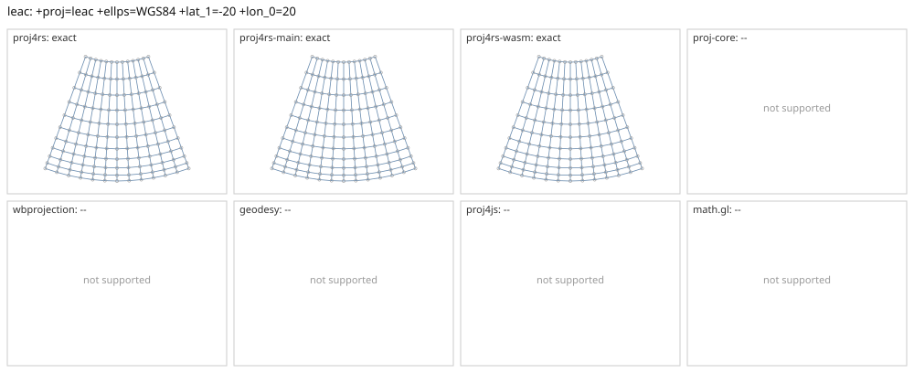

# leac

<!-- generated by report/projections.py from suites/projections/reference.json and engine results; do not edit -->

[Projections grid](../README.md) / [PROJ round trip](../proj-check.md) / [suite](../../../suites/projections/README.md)

```
+proj=leac +ellps=WGS84 +lat_1=-20 +lon_0=20
```

Source lon/lat for every engine: `+proj=longlat +ellps=WGS84 +no_defs`. Window lon [-40, 80], lat [-60, 40], every 10 deg: 143 points, 143 projected by PROJ 9.10.0.

PROJ round trip (its inverse of its forward): worst 9.2e-14 deg at [-20, -50].



Blue: the graticule as each engine draws it. Grey rings: PROJ's points. Red rings: points where the engine is 1 m or more from PROJ, or gives nothing.

| engine | version | verdict | forward, worst | at lon, lat | inverse, worst | at lon, lat | no forward | no inverse | answers where PROJ refuses |
|---|---|---|---|---|---|---|---|---|---|
| proj4rs | 0.2.1 | exact | <1 nm | [-40, 40] | 1.1e-13 deg | [-40, -60] |  |  |  |
| proj4rs-main | git main | exact | <1 nm | [-40, -20] | 1.1e-13 deg | [10, -60] |  |  |  |
| proj4rs-wasm | git 60fee16 2026-10-26 | exact | <1 nm | [-40, -20] | 1.1e-13 deg | [10, -60] |  |  |  |
| proj-core | 0.12.0 | -- | failed to parse CRS string: unsupported PROJ projection: leac | | | | | | |
| wbprojection | 0.3.3 | -- | unsupported projection: PROJ +proj=leac is not supported by wbprojection | | | | | | |
| terrio-crs | 0.1.0 + fallback | -- | coordinate reference system: unsupported projection: PROJ +proj=leac is not supported by wbprojection | | | | | | |
| geodesy | 0.15.0 | -- | Operator 'leac' not found: leac ellps=WGS84 lat_1=-20 lon_0=20 | | | | | | |
| proj4js | 2.22.0 | -- | Could not get projection name from: +proj=leac +ellps=WGS84 +lat_1=-20 +lon_0=20 | | | | | | |
| math.gl | 5.0.0-alpha.18 | -- | Projection plugin is not registered: leac | | | | | | |
