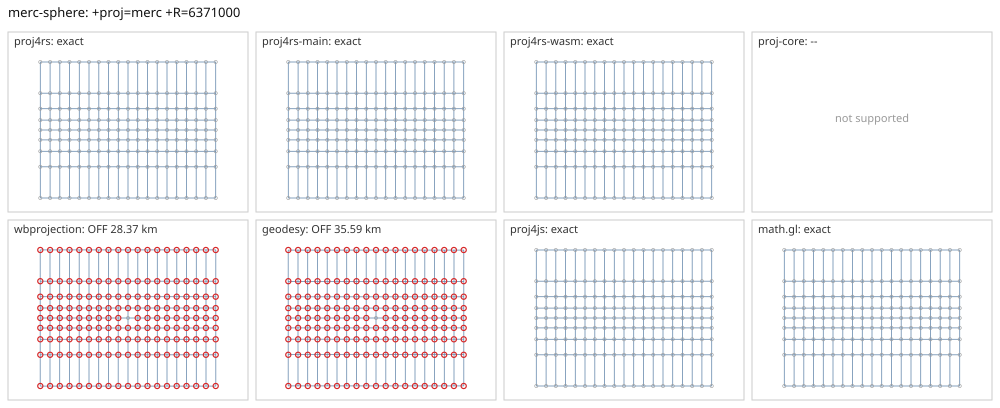

# merc-sphere

<!-- generated by report/projections.py from suites/projections/reference.json and engine results; do not edit -->

[Projections grid](../README.md) / [PROJ round trip](../proj-check.md) / [suite](../../../suites/projections/README.md)

```
+proj=merc +R=6371000
```

Source lon/lat for every engine: `+proj=longlat +R=6371000 +no_defs`. Window lon [-180, 180], lat [-80, 80], every 20 deg: 171 points, 171 projected by PROJ 9.10.0.

PROJ round trip (its inverse of its forward): worst 7.1e-15 deg at [-180, -60].



Blue: the graticule as each engine draws it. Grey rings: PROJ's points. Red rings: points where the engine is 1 m or more from PROJ, or gives nothing.

| engine | version | verdict | forward, worst | at lon, lat | inverse, worst | at lon, lat | no forward | no inverse | answers where PROJ refuses |
|---|---|---|---|---|---|---|---|---|---|
| proj4rs | 0.2.1 | exact | 0 |  | 2.8e-14 deg | [-120, 0] |  |  |  |
| proj4rs-main | git main | exact | 0 |  | 2.8e-14 deg | [-120, 0] |  |  |  |
| proj4rs-wasm | git d9a6284 2026-10-22 | exact | 0 |  | 0 |  |  |  |  |
| proj-core | 0.12.0 | -- | geographic: unsupported CRS semantics: PROJ geographic CRS definition uses unsupported PROJ parameter `+r`: custom ellipsoid parameters are not supported; use a supported +ellps value | | | | | | |
| wbprojection | 0.3.3 | OFF 28.37 km | 28.37 km | [-180, 80] | 0.2 deg | [-180, 0] |  |  |  |
| geodesy | 0.15.0 | OFF 35.59 km | 35.59 km | [-180, -60] | 0.22 deg | [-180, -40] |  |  |  |
| proj4js | 2.22.0 | exact | <1 nm | [-180, 80] | 1.4e-14 deg | [-180, -80] |  |  |  |
| math.gl | 5.0.0-alpha.18 | exact | 0 |  | 3.6e-15 deg | [-180, -20] |  |  |  |
