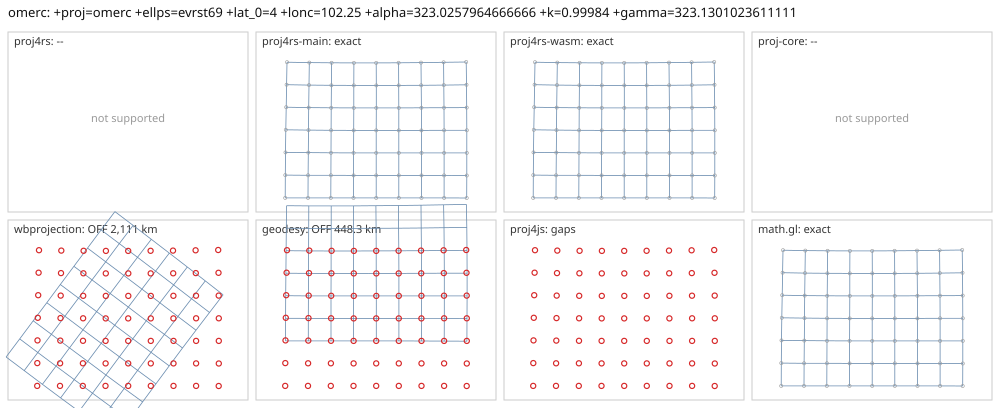

# omerc

<!-- generated by report/projections.py from suites/projections/reference.json and engine results; do not edit -->

[Projections grid](../README.md) / [PROJ round trip](../proj-check.md) / [suite](../../../suites/projections/README.md)

```
+proj=omerc +ellps=evrst69 +lat_0=4 +lonc=102.25 +alpha=323.0257964666666 +k=0.99984 +gamma=323.1301023611111
```

Source lon/lat for every engine: `+proj=longlat +ellps=evrst69 +no_defs`. Window lon [95, 112], lat [-2, 10], every 2 deg: 63 points, 63 projected by PROJ 9.10.0.

PROJ round trip (its inverse of its forward): worst 2.6e-14 deg at [95, 4].



Blue: the graticule as each engine draws it. Grey rings: PROJ's points. Red rings: points where the engine is 1 m or more from PROJ, or gives nothing.

| engine | version | verdict | forward, worst | at lon, lat | inverse, worst | at lon, lat | no forward | no inverse | answers where PROJ refuses |
|---|---|---|---|---|---|---|---|---|---|
| proj4rs | 0.2.1 | -- | Projection not found | | | | | | |
| proj4rs-main | git main | exact | <1 nm | [99, -2] | 2.6e-11 deg | [95, -2] |  |  |  |
| proj4rs-wasm | git d9a6284 2026-10-22 | exact | <1 nm | [99, -2] | 2.6e-11 deg | [95, -2] |  |  |  |
| proj-core | 0.12.0 | -- | geographic: failed to parse CRS string: unsupported PROJ ellipsoid: EVRST69 | | | | | | |
| wbprojection | 0.3.3 | OFF 2,111 km | 2,111 km | [111, -2] | 19 deg | [111, -2] |  |  |  |
| terrio-crs | 0.1.0 + fallback | exact | <1 nm | [99, -2] | 3e-14 deg | [97, 10] |  |  |  |
| geodesy | 0.15.0 | OFF 448.3 km | 448.3 km | [111, 10] | 4 deg | [103, 2] |  |  |  |
| proj4js | 2.22.0 | gaps | 0 |  | 0 |  | 63 | 63 |  |
| math.gl | 5.0.0-alpha.18 | exact | <1 nm | [99, -2] | 2.6e-11 deg | [95, -2] |  |  |  |
