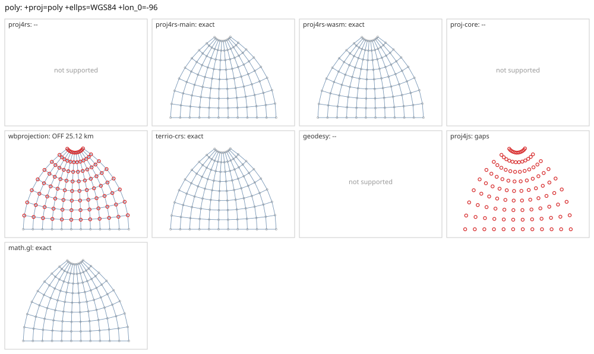

# poly

<!-- generated by report/projections.py from suites/projections/reference.json and engine results; do not edit -->

[Projections grid](../README.md) / [PROJ round trip](../proj-check.md) / [suite](../../../suites/projections/README.md)

```
+proj=poly +ellps=WGS84 +lon_0=-96
```

Source lon/lat for every engine: `+proj=longlat +ellps=WGS84 +no_defs`. Window lon [-150, -40], lat [0, 80], every 10 deg: 108 points, 108 projected by PROJ 9.10.0.

PROJ round trip (its inverse of its forward): worst 3.1e-13 deg at [-40, 80].



Blue: the graticule as each engine draws it. Grey rings: PROJ's points. Red rings: points where the engine is 1 m or more from PROJ, or gives nothing.

| engine | version | verdict | forward, worst | at lon, lat | inverse, worst | at lon, lat | no forward | no inverse | answers where PROJ refuses |
|---|---|---|---|---|---|---|---|---|---|
| proj4rs | 0.2.1 | -- | Projection not found | | | | | | |
| proj4rs-main | git main | exact | 0 |  | 4.1e-13 deg | [-40, 80] |  |  |  |
| proj4rs-wasm | git d9a6284 2026-10-22 | exact | <1 nm | [-60, 40] | 2e-13 deg | [-100, 80] |  |  |  |
| proj-core | 0.12.0 | -- | failed to parse CRS string: unsupported PROJ projection: poly | | | | | | |
| wbprojection | 0.3.3 | OFF 25.12 km | 25.12 km | [-100, 50] | 0.23 deg | [-100, 50] |  | 8 |  |
| geodesy | 0.15.0 | -- | Operator 'poly' not found: poly ellps=WGS84 lon_0=-96 | | | | | | |
| proj4js | 2.22.0 | gaps | 0 |  | 0 |  | 108 | 108 |  |
| math.gl | 5.0.0-alpha.18 | exact | 0.956 mm | [-120, 70] | 8.6e-09 deg | [-100, 70] |  |  |  |
