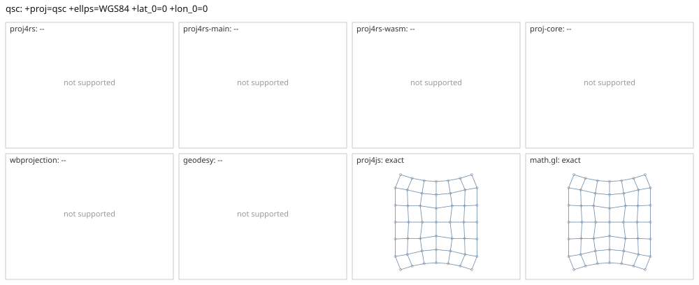

# qsc

<!-- generated by report/projections.py from suites/projections/reference.json and engine results; do not edit -->

[Projections grid](../README.md) / [PROJ round trip](../proj-check.md) / [suite](../../../suites/projections/README.md)

```
+proj=qsc +ellps=WGS84 +lat_0=0 +lon_0=0
```

Source lon/lat for every engine: `+proj=longlat +ellps=WGS84 +no_defs`. Window lon [-45, 45], lat [-45, 45], every 15 deg: 49 points, 49 projected by PROJ 9.10.0.

PROJ round trip (its inverse of its forward): worst 7e-14 deg at [45, -45].



Blue: the graticule as each engine draws it. Grey rings: PROJ's points. Red rings: points where the engine is 1 m or more from PROJ, or gives nothing.

| engine | version | verdict | forward, worst | at lon, lat | inverse, worst | at lon, lat | no forward | no inverse | answers where PROJ refuses |
|---|---|---|---|---|---|---|---|---|---|
| proj4rs | 0.2.1 | -- | Projection not found | | | | | | |
| proj4rs-main | git main | -- | Projection not found | | | | | | |
| proj4rs-wasm | git d9a6284 2026-10-22 | -- | Projection not found | | | | | | |
| proj-core | 0.12.0 | -- | failed to parse CRS string: unsupported PROJ projection: qsc | | | | | | |
| wbprojection | 0.3.3 | -- | unsupported projection: PROJ +proj=qsc is not supported by wbprojection | | | | | | |
| terrio-crs | 0.1.0 + fallback | -- | coordinate reference system: unsupported projection: PROJ +proj=qsc is not supported by wbprojection | | | | | | |
| geodesy | 0.15.0 | -- | Operator 'qsc' not found: qsc ellps=WGS84 lat_0=0 lon_0=0 | | | | | | |
| proj4js | 2.22.0 | exact | 0.00318 mm | [-45, -45] | 1.3e-11 deg | [-45, -30] |  |  |  |
| math.gl | 5.0.0-alpha.18 | exact | 0.00318 mm | [-45, -45] | 1.3e-11 deg | [-45, -30] |  |  |  |
