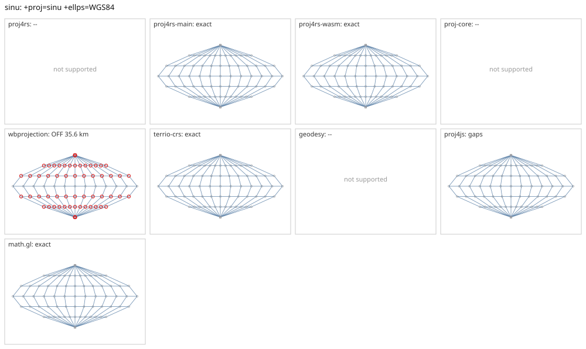

# sinu

<!-- generated by report/projections.py from suites/projections/reference.json and engine results; do not edit -->

[Projections grid](../README.md) / [PROJ round trip](../proj-check.md) / [suite](../../../suites/projections/README.md)

```
+proj=sinu +ellps=WGS84
```

Source lon/lat for every engine: `+proj=longlat +ellps=WGS84 +no_defs`. Window lon [-180, 180], lat [-90, 90], every 30 deg: 91 points, 91 projected by PROJ 9.10.0.

PROJ round trip (its inverse of its forward): worst 2.5e-14 deg at [-180, -30].



Blue: the graticule as each engine draws it. Grey rings: PROJ's points. Red rings: points where the engine is 1 m or more from PROJ, or gives nothing.

| engine | version | verdict | forward, worst | at lon, lat | inverse, worst | at lon, lat | no forward | no inverse | answers where PROJ refuses |
|---|---|---|---|---|---|---|---|---|---|
| proj4rs | 0.2.1 | -- | Projection not found | | | | | | |
| proj4rs-main | git main | exact | 0 |  | 0 |  |  |  |  |
| proj4rs-wasm | git d9a6284 2026-10-22 | exact | 0 |  | 0 |  |  |  |  |
| proj-core | 0.12.0 | -- | failed to parse CRS string: unsupported PROJ projection: sinu | | | | | | |
| wbprojection | 0.3.3 | OFF 35.6 km | 35.6 km | [-180, -60] | 0.44 deg | [-180, -60] |  |  |  |
| terrio-crs | 0.1.0 + fallback | exact | 0.0033 mm | [-180, -60] | 8.6e-11 deg | [-180, -60] |  |  |  |
| geodesy | 0.15.0 | -- | Operator 'sinu' not found: sinu ellps=WGS84 | | | | | | |
| proj4js | 2.22.0 | gaps | 0.0033 mm | [-150, -60] | 0 |  |  | 91 |  |
| math.gl | 5.0.0-alpha.18 | exact | 0.0033 mm | [-150, -60] | 8.6e-11 deg | [-180, -60] |  |  |  |
