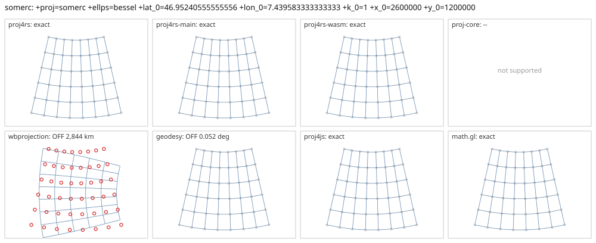

# somerc

<!-- generated by report/projections.py from suites/projections/reference.json and engine results; do not edit -->

[Projections grid](../README.md) / [PROJ round trip](../proj-check.md) / [suite](../../../suites/projections/README.md)

```
+proj=somerc +ellps=bessel +lat_0=46.95240555555556 +lon_0=7.439583333333333 +k_0=1 +x_0=2600000 +y_0=1200000
```

Source lon/lat for every engine: `+proj=longlat +ellps=bessel +no_defs`. Window lon [-10, 25], lat [35, 60], every 5 deg: 48 points, 48 projected by PROJ 9.10.0.

PROJ round trip (its inverse of its forward): worst 4.3e-14 deg at [-10, 45].



Blue: the graticule as each engine draws it. Grey rings: PROJ's points. Red rings: points where the engine is 1 m or more from PROJ, or gives nothing.

| engine | version | verdict | forward, worst | at lon, lat | inverse, worst | at lon, lat | no forward | no inverse | answers where PROJ refuses |
|---|---|---|---|---|---|---|---|---|---|
| proj4rs | 0.2.1 | exact | 0 |  | 7.1e-15 deg | [-10, 40] |  |  |  |
| proj4rs-main | git main | exact | 0 |  | 7.1e-15 deg | [-10, 40] |  |  |  |
| proj4rs-wasm | git 60fee16 2026-10-26 | exact | <1 nm | [0, 35] | 2.1e-14 deg | [-10, 35] |  |  |  |
| proj-core | 0.12.0 | -- | failed to parse CRS string: unsupported PROJ projection: somerc | | | | | | |
| wbprojection | 0.3.3 | OFF 2,844 km | 2,844 km | [25, 35] | 25 deg | [25, 35] |  |  |  |
| terrio-crs | 0.1.0 + fallback | exact | 0 |  | 7.1e-15 deg | [-10, 40] |  |  |  |
| geodesy | 0.15.0 | OFF 0.052 deg | <1 nm | [15, 40] | 0.052 deg | [0, 55] |  |  |  |
| proj4js | 2.22.0 | exact | <1 nm | [15, 55] | 1.8e-09 deg | [-5, 40] |  |  |  |
| math.gl | 5.0.0-alpha.18 | exact | <1 nm | [15, 55] | 1.8e-09 deg | [-5, 40] |  |  |  |
