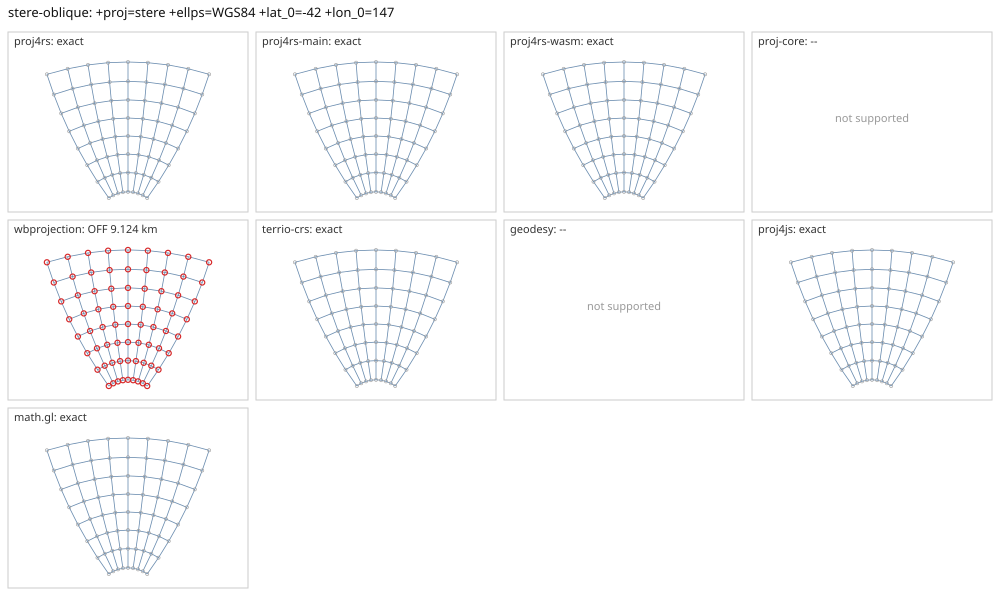

# stere-oblique

<!-- generated by report/projections.py from suites/projections/reference.json and engine results; do not edit -->

[Projections grid](../README.md) / [PROJ round trip](../proj-check.md) / [suite](../../../suites/projections/README.md)

```
+proj=stere +ellps=WGS84 +lat_0=-42 +lon_0=147
```

Source lon/lat for every engine: `+proj=longlat +ellps=WGS84 +no_defs`. Window lon [107, 187], lat [-75, -5], every 10 deg: 72 points, 72 projected by PROJ 9.10.0.

PROJ round trip (its inverse of its forward): worst 4.3e-12 deg at [187, -55].



Blue: the graticule as each engine draws it. Grey rings: PROJ's points. Red rings: points where the engine is 1 m or more from PROJ, or gives nothing.

| engine | version | verdict | forward, worst | at lon, lat | inverse, worst | at lon, lat | no forward | no inverse | answers where PROJ refuses |
|---|---|---|---|---|---|---|---|---|---|
| proj4rs | 0.2.1 | exact | <1 nm | [187, -15] | 1.4e-14 deg | [167, -25] |  |  |  |
| proj4rs-main | git main | exact | <1 nm | [187, -15] | 1.4e-14 deg | [167, -25] |  |  |  |
| proj4rs-wasm | git d9a6284 2026-10-22 | exact | <1 nm | [187, -15] | 3.7e-14 deg | [187, -65] |  |  |  |
| proj-core | 0.12.0 | -- | failed to parse CRS string: only polar stereographic PROJ strings are supported | | | | | | |
| wbprojection | 0.3.3 | OFF 9.124 km | 9.124 km | [187, -5] | 0.067 deg | [107, -5] |  |  |  |
| geodesy | 0.15.0 | -- | Operator 'stere' not found: stere ellps=WGS84 lat_0=-42 lon_0=147 | | | | | | |
| proj4js | 2.22.0 | exact | <1 nm | [187, -15] | 3.1e-14 deg | [187, -5] |  |  |  |
| math.gl | 5.0.0-alpha.18 | exact | <1 nm | [187, -15] | 3.1e-14 deg | [187, -5] |  |  |  |
