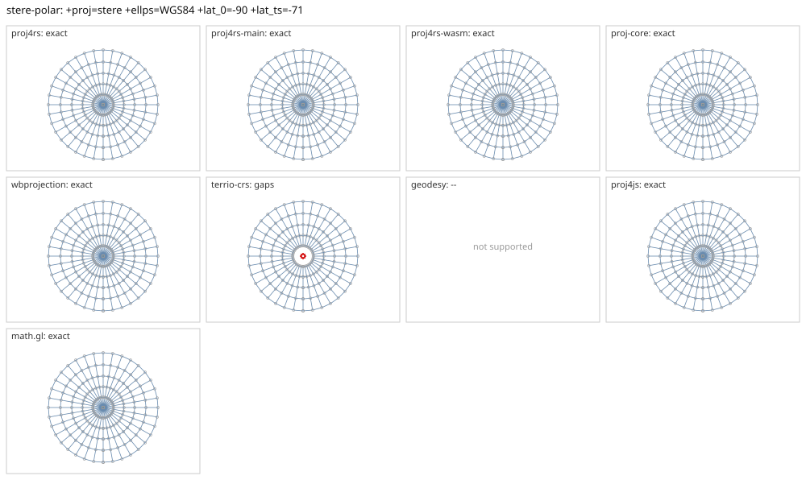

# stere-polar

<!-- generated by report/projections.py from suites/projections/reference.json and engine results; do not edit -->

[Projections grid](../README.md) / [PROJ round trip](../proj-check.md) / [suite](../../../suites/projections/README.md)

```
+proj=stere +ellps=WGS84 +lat_0=-90 +lat_ts=-71
```

Source lon/lat for every engine: `+proj=longlat +ellps=WGS84 +no_defs`. Window lon [-180, 180], lat [-90, -40], every 10 deg: 222 points, 222 projected by PROJ 9.10.0.

PROJ round trip (its inverse of its forward): worst 1.1e-11 deg at [-170, -50].



Blue: the graticule as each engine draws it. Grey rings: PROJ's points. Red rings: points where the engine is 1 m or more from PROJ, or gives nothing.

| engine | version | verdict | forward, worst | at lon, lat | inverse, worst | at lon, lat | no forward | no inverse | answers where PROJ refuses |
|---|---|---|---|---|---|---|---|---|---|
| proj4rs | 0.2.1 | exact | <1 nm | [-130, -40] | 1.4e-14 deg | [-180, -70] |  |  |  |
| proj4rs-main | git main | exact | <1 nm | [-130, -40] | 1.4e-14 deg | [-180, -70] |  |  |  |
| proj4rs-wasm | git 9996719 2026-10-21 | exact | <1 nm | [-130, -40] | 2.3e-14 deg | [-120, -40] |  |  |  |
| proj-core | 0.12.0 | exact | <1 nm | [70, -40] | 1.1e-11 deg | [70, -50] |  |  |  |
| wbprojection | 0.3.3 | exact | <1 nm | [-150, -40] | 1.1e-11 deg | [-170, -50] |  |  |  |
| geodesy | 0.15.0 | -- | Operator 'stere' not found: stere ellps=WGS84 lat_0=-90 lat_ts=-71 | | | | | | |
| proj4js | 2.22.0 | exact | <1 nm | [-160, -70] | 2.2e-14 deg | [-120, -40] |  |  |  |
| math.gl | 5.0.0-alpha.18 | exact | <1 nm | [-160, -70] | 2.2e-14 deg | [-120, -40] |  |  |  |
