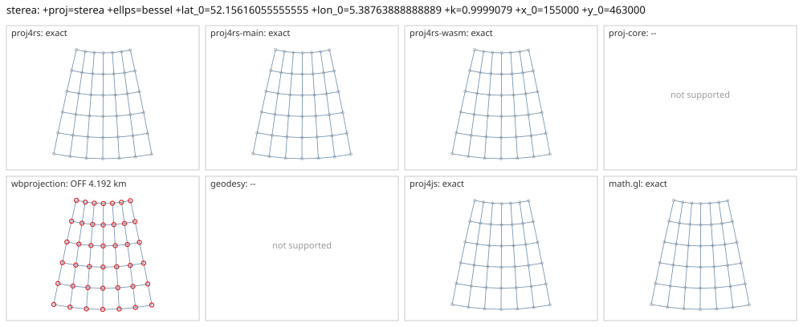

# sterea

<!-- generated by report/projections.py from suites/projections/reference.json and engine results; do not edit -->

[Projections grid](../README.md) / [PROJ round trip](../proj-check.md) / [suite](../../../suites/projections/README.md)

```
+proj=sterea +ellps=bessel +lat_0=52.15616055555555 +lon_0=5.38763888888889 +k=0.9999079 +x_0=155000 +y_0=463000
```

Source lon/lat for every engine: `+proj=longlat +ellps=bessel +no_defs`. Window lon [-10, 20], lat [40, 65], every 5 deg: 42 points, 42 projected by PROJ 9.10.0.

PROJ round trip (its inverse of its forward): worst 2.8e-14 deg at [-10, 65].



Blue: the graticule as each engine draws it. Grey rings: PROJ's points. Red rings: points where the engine is 1 m or more from PROJ, or gives nothing.

| engine | version | verdict | forward, worst | at lon, lat | inverse, worst | at lon, lat | no forward | no inverse | answers where PROJ refuses |
|---|---|---|---|---|---|---|---|---|---|
| proj4rs | 0.2.1 | exact | 0 |  | 2.8e-14 deg | [0, 65] |  |  |  |
| proj4rs-main | git main | exact | 0 |  | 2.8e-14 deg | [0, 65] |  |  |  |
| proj4rs-wasm | git 9996719 2026-10-21 | exact | <1 nm | [-10, 50] | 2.8e-14 deg | [-10, 65] |  |  |  |
| proj-core | 0.12.0 | -- | operation selection failed: no compatible registry operation found for source EPSG:0 target EPSG:0 | | | | | | |
| wbprojection | 0.3.3 | OFF 4.192 km | 4.192 km | [-10, 65] | 0.037 deg | [-10, 65] |  |  |  |
| geodesy | 0.15.0 | -- | Operator 'sterea' not found: sterea ellps=bessel lat_0=52.15616055555555 lon_0=5.38763888888889 k_0=0.9999079 x_0=155000 y_0=463000 | | | | | | |
| proj4js | 2.22.0 | exact | <1 nm | [-10, 45] | 2.8e-14 deg | [-10, 65] |  |  |  |
| math.gl | 5.0.0-alpha.18 | exact | <1 nm | [-10, 45] | 2.8e-14 deg | [-10, 65] |  |  |  |
