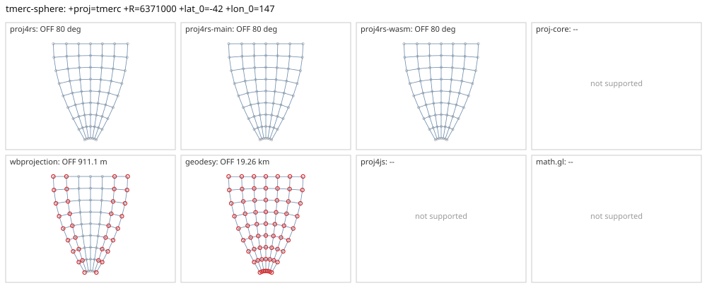

# tmerc-sphere

<!-- generated by report/projections.py from suites/projections/reference.json and engine results; do not edit -->

[Projections grid](../README.md) / [PROJ round trip](../proj-check.md) / [suite](../../../suites/projections/README.md)

```
+proj=tmerc +R=6371000 +lat_0=-42 +lon_0=147
```

Source lon/lat for every engine: `+proj=longlat +R=6371000 +no_defs`. Window lon [117, 177], lat [-80, 0], every 10 deg: 63 points, 63 projected by PROJ 9.10.0.

Why this entry: spherical tmerc at and near lat_0 (PROJ ca23885d, 2026-02).

PROJ round trip (its inverse of its forward): worst 2.1e-14 deg at [177, -60].



Blue: the graticule as each engine draws it. Grey rings: PROJ's points. Red rings: points where the engine is 1 m or more from PROJ, or gives nothing.

| engine | version | verdict | forward, worst | at lon, lat | inverse, worst | at lon, lat | no forward | no inverse | answers where PROJ refuses |
|---|---|---|---|---|---|---|---|---|---|
| proj4rs | 0.2.1 | OFF 80 deg | 94.9 mm | [117, 0] | 80 deg | [157, -40] |  |  |  |
| proj4rs-main | git main | OFF 80 deg | 94.9 mm | [117, 0] | 80 deg | [157, -40] |  |  |  |
| proj4rs-wasm | git 9996719 2026-10-21 | OFF 80 deg | 94.9 mm | [117, 0] | 80 deg | [157, -40] |  |  |  |
| proj-core | 0.12.0 | -- | geographic: unsupported CRS semantics: PROJ geographic CRS definition uses unsupported PROJ parameter `+r`: custom ellipsoid parameters are not supported; use a supported +ellps value | | | | | | |
| wbprojection | 0.3.3 | OFF 911.1 m | 911.1 m | [177, 0] | 0.052 deg | [177, -60] |  |  |  |
| geodesy | 0.15.0 | OFF 19.26 km | 19.26 km | [117, 0] | 0.17 deg | [147, 0] |  |  |  |
| proj4js | 2.22.0 | -- | Incorrect elliptical usage. Try using the +approx option in the proj string, or PROJECTION["Fast_Transverse_Mercator"] in the WKT. | | | | | | |
| math.gl | 5.0.0-alpha.18 | -- | Spherical transverse Mercator requires +approx | | | | | | |
