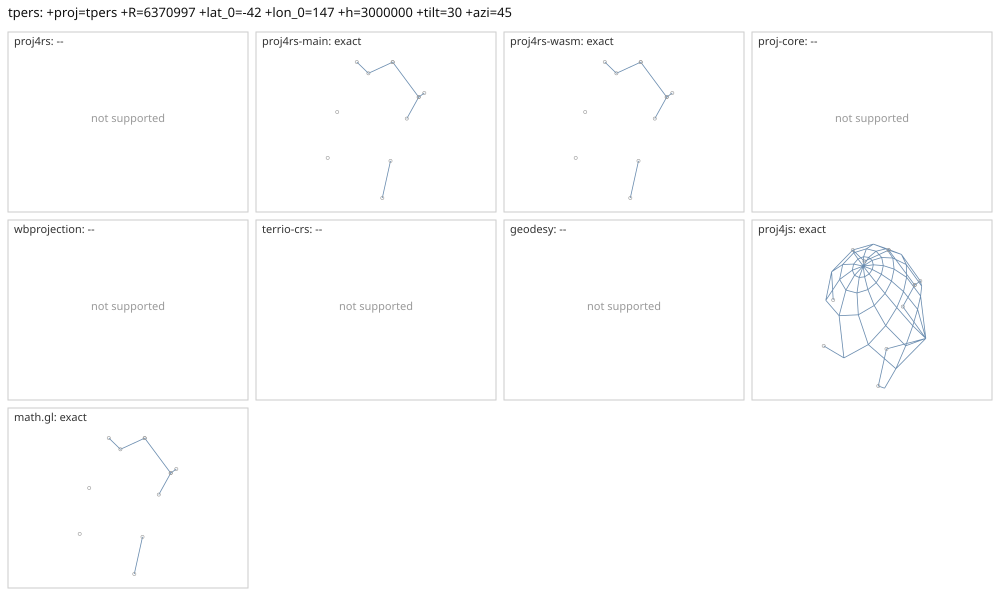

# tpers

<!-- generated by report/projections.py from suites/projections/reference.json and engine results; do not edit -->

[Projections grid](../README.md) / [PROJ round trip](../proj-check.md) / [suite](../../../suites/projections/README.md)

```
+proj=tpers +R=6370997 +lat_0=-42 +lon_0=147 +h=3000000 +tilt=30 +azi=45
```

Source lon/lat for every engine: `+proj=longlat +R=6370997 +no_defs`. Window lon [-180, 180], lat [-90, 90], every 30 deg: 91 points, 12 projected by PROJ 9.10.0.

PROJ round trip (its inverse of its forward): worst 1.2e-12 deg at [90, -30].



Blue: the graticule as each engine draws it. Grey rings: PROJ's points. Red rings: points where the engine is 1 m or more from PROJ, or gives nothing.

| engine | version | verdict | forward, worst | at lon, lat | inverse, worst | at lon, lat | no forward | no inverse | answers where PROJ refuses |
|---|---|---|---|---|---|---|---|---|---|
| proj4rs | 0.2.1 | -- | Projection not found | | | | | | |
| proj4rs-main | git main | exact | 0 |  | 1.4e-14 deg | [-150, -60] |  |  |  |
| proj4rs-wasm | git 60fee16 2026-10-26 | exact | 0 |  | 1.4e-14 deg | [-150, -60] |  |  |  |
| proj-core | 0.12.0 | -- | geographic: unsupported CRS semantics: PROJ geographic CRS definition uses unsupported PROJ parameter `+r`: custom ellipsoid parameters are not supported; use a supported +ellps value | | | | | | |
| wbprojection | 0.3.3 | -- | unsupported projection: PROJ +proj=tpers is not supported by wbprojection | | | | | | |
| terrio-crs | 0.1.0 + fallback | -- | coordinate reference system: unsupported projection: PROJ +proj=tpers is not supported by wbprojection | | | | | | |
| geodesy | 0.15.0 | -- | Operator 'tpers' not found: tpers R=6370997 lat_0=-42 lon_0=147 h=3000000 tilt=30 azi=45 | | | | | | |
| proj4js | 2.22.0 | exact | <1 nm | [-150, -60] | 2.4e-13 deg | [90, -30] |  |  | 79 |
| math.gl | 5.0.0-alpha.18 | exact | <1 nm | [-150, -60] | 2.4e-13 deg | [90, -30] |  |  |  |
