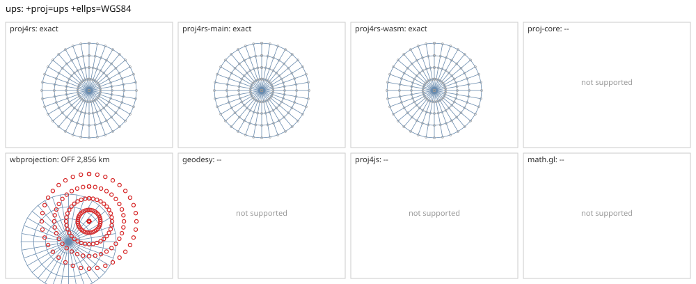

# ups

<!-- generated by report/projections.py from suites/projections/reference.json and engine results; do not edit -->

[Projections grid](../README.md) / [PROJ round trip](../proj-check.md) / [suite](../../../suites/projections/README.md)

```
+proj=ups +ellps=WGS84
```

Source lon/lat for every engine: `+proj=longlat +ellps=WGS84 +no_defs`. Window lon [-180, 180], lat [50, 90], every 10 deg: 185 points, 185 projected by PROJ 9.10.0.

PROJ round trip (its inverse of its forward): worst 1.1e-11 deg at [-140, 50].



Blue: the graticule as each engine draws it. Grey rings: PROJ's points. Red rings: points where the engine is 1 m or more from PROJ, or gives nothing.

| engine | version | verdict | forward, worst | at lon, lat | inverse, worst | at lon, lat | no forward | no inverse | answers where PROJ refuses |
|---|---|---|---|---|---|---|---|---|---|
| proj4rs | 0.2.1 | exact | <1 nm | [120, 70] | 9.7e-15 deg | [150, 70] |  |  |  |
| proj4rs-main | git main | exact | <1 nm | [120, 70] | 9.7e-15 deg | [150, 70] |  |  |  |
| proj4rs-wasm | git 60fee16 2026-10-26 | exact | <1 nm | [120, 70] | 1.4e-14 deg | [120, 60] |  |  |  |
| proj-core | 0.12.0 | -- | failed to parse CRS string: unsupported PROJ projection: ups | | | | | | |
| wbprojection | 0.3.3 | OFF 2,856 km | 2,856 km | [-50, 50] | 56 deg | [-50, 70] |  |  |  |
| terrio-crs | 0.1.0 + fallback | gaps | <1 nm | [120, 70] | 1.4e-14 deg | [-120, 70] | 37 |  |  |
| geodesy | 0.15.0 | -- | Operator 'ups' not found: ups ellps=WGS84 | | | | | | |
| proj4js | 2.22.0 | -- | Could not get projection name from: +proj=ups +ellps=WGS84 | | | | | | |
| math.gl | 5.0.0-alpha.18 | -- | Projection plugin is not registered: ups | | | | | | |
