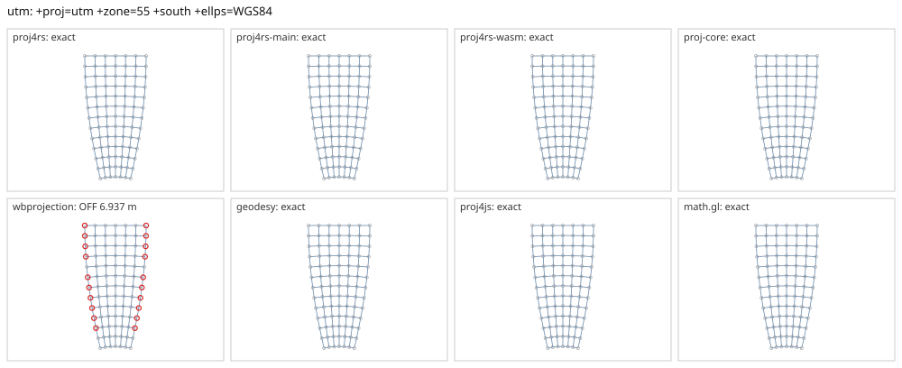

# utm

<!-- generated by report/projections.py from suites/projections/reference.json and engine results; do not edit -->

[Projections grid](../README.md) / [PROJ round trip](../proj-check.md) / [suite](../../../suites/projections/README.md)

```
+proj=utm +zone=55 +south +ellps=WGS84
```

Source lon/lat for every engine: `+proj=longlat +ellps=WGS84 +no_defs`. Window lon [132, 162], lat [-60, 0], every 5 deg: 91 points, 91 projected by PROJ 9.10.0.

PROJ round trip (its inverse of its forward): worst 2.8e-14 deg at [132, -10].



Blue: the graticule as each engine draws it. Grey rings: PROJ's points. Red rings: points where the engine is 1 m or more from PROJ, or gives nothing.

| engine | version | verdict | forward, worst | at lon, lat | inverse, worst | at lon, lat | no forward | no inverse | answers where PROJ refuses |
|---|---|---|---|---|---|---|---|---|---|
| proj4rs | 0.2.1 | exact | <1 nm | [142, -25] | 2.8e-14 deg | [132, -10] |  |  |  |
| proj4rs-main | git main | exact | <1 nm | [142, -25] | 2.8e-14 deg | [132, -10] |  |  |  |
| proj4rs-wasm | git 9996719 2026-10-21 | exact | <1 nm | [162, -35] | 2.8e-14 deg | [132, -10] |  |  |  |
| proj-core | 0.12.0 | exact | <1 nm | [132, -5] | 3.3e-14 deg | [147, -5] |  |  |  |
| wbprojection | 0.3.3 | OFF 6.937 m | 6.937 m | [162, 0] | 0.00029 deg | [162, -55] |  |  |  |
| geodesy | 0.15.0 | exact | <1 nm | [132, -5] | 3.3e-14 deg | [147, -5] |  |  |  |
| proj4js | 2.22.0 | exact | <1 nm | [132, -10] | 2.8e-14 deg | [132, 0] |  |  |  |
| math.gl | 5.0.0-alpha.18 | exact | <1 nm | [132, -10] | 2.8e-14 deg | [132, 0] |  |  |  |
