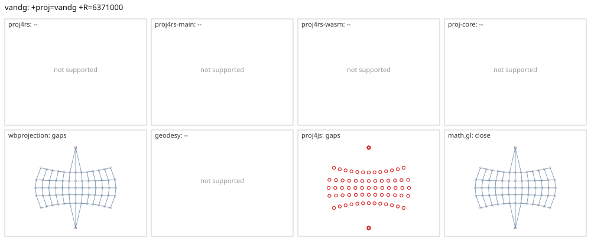

# vandg

<!-- generated by report/projections.py from suites/projections/reference.json and engine results; do not edit -->

[Projections grid](../README.md) / [PROJ round trip](../proj-check.md) / [suite](../../../suites/projections/README.md)

```
+proj=vandg +R=6371000
```

Source lon/lat for every engine: `+proj=longlat +R=6371000 +no_defs`. Window lon [-180, 180], lat [-90, 90], every 30 deg: 91 points, 91 projected by PROJ 9.10.0.

PROJ round trip (its inverse of its forward): worst 4.2e-13 deg at [-30, -30].



Blue: the graticule as each engine draws it. Grey rings: PROJ's points. Red rings: points where the engine is 1 m or more from PROJ, or gives nothing.

| engine | version | verdict | forward, worst | at lon, lat | inverse, worst | at lon, lat | no forward | no inverse | answers where PROJ refuses |
|---|---|---|---|---|---|---|---|---|---|
| proj4rs | 0.2.1 | -- | Projection not found | | | | | | |
| proj4rs-main | git main | -- | Projection not found | | | | | | |
| proj4rs-wasm | git 9996719 2026-10-21 | -- | Projection not found | | | | | | |
| proj-core | 0.12.0 | -- | geographic: unsupported CRS semantics: PROJ geographic CRS definition uses unsupported PROJ parameter `+r`: custom ellipsoid parameters are not supported; use a supported +ellps value | | | | | | |
| wbprojection | 0.3.3 | gaps | <1 nm | [-30, -30] | 3.3e-12 deg | [150, 30] |  | 6 |  |
| geodesy | 0.15.0 | -- | Operator 'vandg' not found: vandg R=6371000 | | | | | | |
| proj4js | 2.22.0 | gaps | 0 |  | 0 |  | 91 | 91 |  |
| math.gl | 5.0.0-alpha.18 | close | <1 nm | [-30, -30] | 8.9e-07 deg | [-180, -90] |  |  |  |
